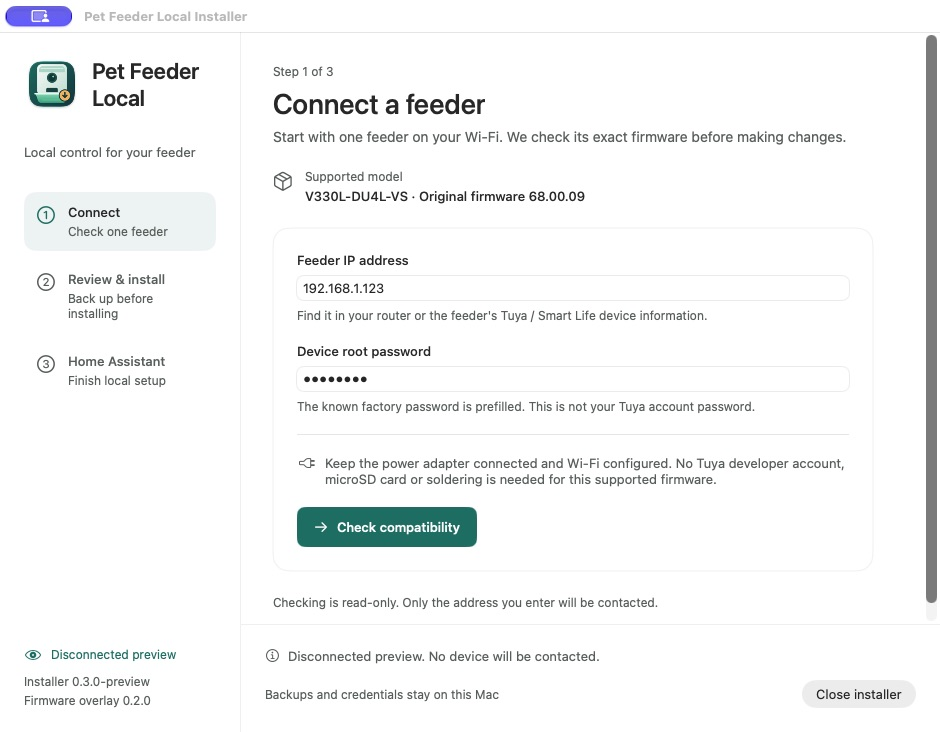
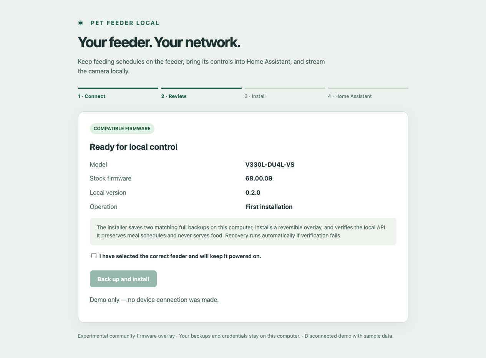

# Pet Feeder Local Firmware

**macOS packaging update:** the old 0.2.0 portable ZIP can be blocked repeatedly for its individual Python libraries. Use the current source installer with a trusted Python installation, or the 0.2.1 `.app` package. The `.app` is currently **not Developer ID signed or notarized**, so macOS may still block it. See [macOS setup](#macos-setup) and [signing status](docs/macos-signing.md).

Installer **0.2.1** still contains firmware overlay **0.2.0**. This is an installer/UI update; an already working feeder does not need its firmware reinstalled.

Give a supported camera feeder local controls, an editable onboard feeding schedule and an authenticated RTSP camera. Pair Wi-Fi once with Tuya or Smart Life, run the installer, then use [Pet Feeder Local for Home Assistant](https://github.com/e2equiel/ha-pet-feeder-local). No Tuya developer account, cloud key or tuya-local integration is required for local operation.

**Experimental community release, tested on one device.** This is a reversible firmware overlay. It retains the original proprietary camera encoder and feeding-controller firmware; it is not a complete open-source replacement image. It changes neither the bootloader nor the read-only kernel/root filesystem. The new API controls the feeding MCU directly and blocks the device's Internet routes.



*Actual installer interface with disconnected demonstration data.*

## Is my feeder supported?

| Required component | Supported profile |
| --- | --- |
| Model / platform | **V330L-DU4L-VS** |
| Original application | **68.00.09** |
| Processor | Anyka AK39EV330, ARMv5TE |
| Linux | 4.4.192V2.1 |
| SPI flash | 8 MiB, seven matching partitions |
| Original application SHA-256 | `f499431d38ed3cb8a4607ee870f06461e14ccb9f6f6387137b0ded2f5191a499` |
| Observed feeding-controller version | 1-C6-XALCD.0.7 |

A similar-looking feeder is not necessarily compatible. The installer checks the exact application fingerprint and flash layout, and refuses unknown versions or another project's boot modification. Do not force an installation or downgrade an unknown device. Additional MCU revisions have not been validated separately.

## Install in four steps

You need a computer on the same LAN, the feeder's power adapter, and permission to modify this feeder. A microSD card, soldering and Tuya developer credentials are not needed for this supported profile.

1. **Connect Wi-Fi once.** Set up the feeder normally with Tuya or Smart Life and confirm it joins your Wi-Fi. Find its private IPv4 address in your router's connected-device list or the app's device information. A DHCP reservation in the router keeps the address stable. Direct installation on a factory-fresh, unpaired feeder has **not** been validated.
2. **Download the complete installer ZIP** from [Releases](https://github.com/e2equiel/pet-feeder-local-firmware/releases). Choose your operating system and CPU and extract it. On macOS, open **PetFeederLocalInstaller.app** with a double-click; Finder may hide the `.app` suffix. On Windows, run `PetFeederLocalInstaller.exe`; on Linux, run `PetFeederLocalInstaller`. A local browser wizard opens. Keep it running until verification finishes, then use **Close installer**. For macOS blocks or a missing portable build, use the source installer below.
3. **Check, review and install.** Enter this feeder's IP address. The published factory root password is prefilled. Click **Check compatibility**, review the detected profile, confirm the selected device, and click **Back up and install**. No device is scanned or selected automatically. Leave the feeder powered on throughout the backup and verification.
4. **Connect Home Assistant.** The completion page shows the local API address and a private token. Use its Marketplace and Add integration buttons, following the [companion quick start](https://github.com/e2equiel/ha-pet-feeder-local#installation). Add the bundled dashboard card through the visual card picker.

| Your computer | Portable ZIP suffix |
| --- | --- |
| Windows on Intel/AMD | `windows-x86_64.zip` |
| Mac with Apple silicon | `macos-arm64.zip` |
| Mac with Intel CPU | `macos-x86_64.zip` |
| Linux on Intel/AMD 64-bit | `linux-x86_64.zip` (built on Ubuntu 24.04) |
| Other supported Python computer | `source-installer.zip` |

The installer saves two complete matching flash reads and a private configuration archive in `Documents/PetFeederLocalBackups/feeder-<timestamp>/` on your computer. Keep that folder private: it contains Wi-Fi/device credentials. `home-assistant-setup.json` stores your API address and token locally after a successful installation. Never attach these files to an issue.

Do not press **Remove device**, factory reset, or change Wi-Fi in the Tuya app during installation: these actions can reset the device's network setup. The app is no longer required for ongoing local controls after installation. If changing Wi-Fi later, restore stock operation first and follow [recovery](docs/recovery.md).

### macOS setup

The portable download contains a normal **PetFeederLocalInstaller.app**. Keep the app intact and double-click it; there is no Terminal command to find inside the bundle. It opens its interface in your default browser and runs in the background. Use **Close installer** in the browser when finished.

The app bundle is currently sealed with an ad-hoc signature for package integrity, **not** a trusted Developer ID signature. Apple notarization is pending. Packaging it as an app fixes the loose runtime layout, but does not guarantee Gatekeeper acceptance. Do not approve individual Python libraries one by one or disable Gatekeeper. If macOS blocks it, the source installer below uses an already installed, trusted Python instead of distributing a second Python runtime.

### Source installer fallback

Install Python 3.10 or newer from [python.org](https://www.python.org/downloads/), download the **source-installer ZIP** from Releases and extract it. Open a terminal in the extracted folder:

```sh
# Windows
py install.py

# macOS / Linux
python3 install.py
```

On macOS with Python already installed from python.org or Homebrew, double-click **Start Installer.command** instead of typing the command. It opens a Terminal window and then the browser wizard. It checks the standard Python locations and explains what to install if no suitable interpreter is available. Keep that window open until you click **Close installer** in the browser.

There are no Python package dependencies. The complete release ZIP includes the built overlay; GitHub's automatic **Source code** archives do not. The program prints a `http://127.0.0.1:<port>/` address if a browser does not open. The source launcher itself may require an initial macOS approval; it contains no bundled macOS Python libraries to approve separately.



## What happens to feeding and video?

- **Choose portions, then Serve.** Changing the portion selection never actuates the motor. An uncertain request is not retried automatically.
- **Save up to eight weekly meals.** Edit weekdays, time, portions and enabled state. The MCU stores and executes its own table; HA and Tuya do not run meal timers. Saving verifies the exact MCU readback and detects concurrent edits.
- **Keep local time valid.** HA synchronizes the MCU's wall clock in HA's configured timezone every five minutes while online. The MCU cannot learn a timezone or DST change while disconnected. Complete power-loss clock retention remains unverified.
- **Use local video.** Main video is HEVC, 1920×1080 at 10 fps, using authenticated RTSP-over-TCP on port 8555. Share one upstream connection through go2rtc when using HA and Frigate together. [Camera setup](docs/camera.md) includes an example. Audio and the separate substream remain unvalidated/not supported for normal setup.

With the complete Linux camera application stopped for 25 seconds, the MCU emitted a scheduled-feeding record independently. Device reboot, local control, saved schedule and RTSP recovery also passed with WAN blocked from boot. **Physical food delivery, battery operation, prolonged offline operation and clock retention after total power loss have not been verified.** The test feeder has no batteries. Before relying on this modification, observe real meals on your own unit and check your intended backup-power behavior. Portions are device units, not a guaranteed food weight.

The retained camera SDK still attempts cloud work. More-specific unreachable IPv4 routes prevent the device from reaching Internet addresses while preserving the connected LAN. DNS queries to a LAN router can still be resolved upstream by that router; this is operational cloud independence, not a claim that every vendor component or indirect DNS query has disappeared.

## Update or restore

Run the same wizard with a newer complete release ZIP and select the same IP address. It checks the current local API, keeps your token and operation journal, backs up the current device, and verifies that meal rows are unchanged. Modules are uploaded into versioned files and activated atomically; a loaded library is never overwritten in place. Device-side rollback runs if the new API cannot be verified, including if the computer disconnects during activation. Keep power on; RAM-based rollback cannot run while the device is unpowered.

To undo the modification, run the wizard, check the device, and choose **Restore stock operation** on the review page. It disables this project's boot hook, restores the original application path and Internet routing, and preserves your feeding table. The stock app may need time to reconnect to Tuya. Backups are retained; the wizard never writes raw flash partitions. See [recovery and troubleshooting](docs/recovery.md).

## Build and verify

Original project sources are MIT licensed; no vendor firmware, binaries, private dumps or recordings are distributed.

```sh
make test                         # Native C tests, ASan + UBSan
# Build the ARMv5TE module in the pinned, target-compatible toolchain.
docker build --platform linux/amd64 -t pet-feeder-local-toolchain -f tools/Dockerfile .
docker run --rm --platform linux/amd64 -v "$PWD:/src" -w /src pet-feeder-local-toolchain make rtsp
python3 tools/check_imports.py build/pf_local.so --allowed tools/target-imports.txt
python3 -m unittest discover -s installer/tests -v
python3 tools/build_release.py    # Validated bundle and complete source-installer ZIP
```

The release build uses the pinned Debian 12 GNU ARM toolchain and pyelftools for the ABI check. Native cross-compilation with a newer distribution can silently introduce time64/fortified libc imports absent from this feeder; the import gate rejects those builds. The public import allowlist contains symbol names verified against the target libc, not a vendor library. The ELF must include both SysV and GNU symbol hashes. `tools/check_imports.py` can compare imports against your own privately extracted target libc (requires pyelftools); installation also checks eager loading on the actual device before activation. CI tests the C codecs, JSON parser, durable feeding journal, installer boundaries and UI request protections, then packages portable installers. Builds run on pushes and releases, with no scheduled workflow.

[Local API](docs/local-api.md) · [MCU protocol](docs/mcu-protocol.md) · [Recovery](docs/recovery.md) · [Validation](docs/validation.md) · [Contributing](CONTRIBUTING.md) · [Security](SECURITY.md)

## Credits

[Published root-access research](https://www.whid.ninja/blog/snhack-attack-how-hackers-could-turn-your-smart-pet-feeder-into-an-all-you-can-eat-buffet) established the factory access route. [Anyka encoder ABI research](https://github.com/thxrben/anyka-rstp/blob/main/docs/libmpi_venc.md) informed the initial analysis, cross-checked against the test unit. [Tuya's pet-camera architecture](https://developer.tuya.com/en/docs/iot-device-dev/pet-camera?id=Kdvgw71qj280g) describes the separate feeding controller.
