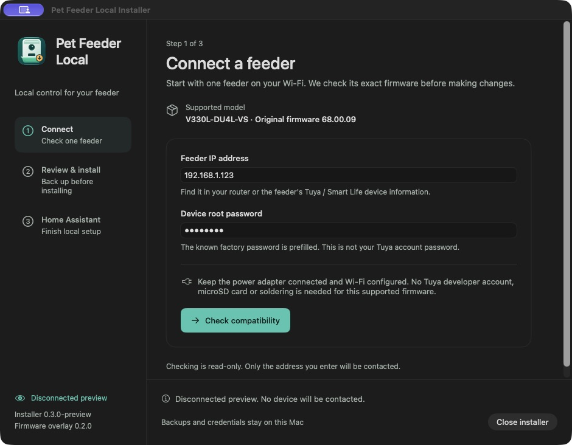

# Interface design

The 0.3 interface is designed for an owner setting up and using one local feeder. It retains the original product icons, uses system typography, neutral surfaces and one restrained accent, and keeps action labels specific. No remote fonts, analytics or UI service is required.

The Mac installer uses SwiftUI and AppKit. The portable wizard uses semantic HTML with adaptive light/dark colors. The Home Assistant card uses Web Components and the current HA theme. These are native surfaces for each host; they do not share an additional UI framework.

## Interaction boundaries

- Compatibility checks name one address and do not imply a network scan.
- Installation remains gated by review and confirmation. Private credentials stay masked and private backup instructions remain visible.
- Choosing portions does not feed. Serve is a separate action and requires a valid selection.
- Enabled schedule rows are counted separately from all saved rows. New rows remain disabled. Unsaved changes and revision conflicts are distinct states.
- A service request or MCU acknowledgement is not proof of physical food delivery. No preview status represents a connected device.

## Verification

Disconnected fixtures cover Mac connection/review, portable connection/review, light/dark appearance, HA card and card editor, empty portions, unsaved edits and narrow layouts at 320 CSS pixels (305 content pixels with a desktop scrollbar). The portable and HA previews have no horizontal page overflow at that width; weekday targets and card buttons are at least 44 pixels tall. Installer boundary tests and card interaction tests run separately. Public screenshots contain synthetic data. Hardware, battery and power-loss verification is unchanged by this UI release; see validation.md.

## Screenshots

## Design references

The review and redesign workflow was adapted from [Unslop](https://github.com/heydamir/unslop) by Damir Sokolovsky, licensed under [CC BY 4.0](https://creativecommons.org/licenses/by/4.0/). Changes here adapt its spacing, color, icon, copy, type, layout, detail and motion review principles to native installer and HA surfaces. Original project source licensing is unchanged.

[UI SDK](https://ui-sdk.dev/docs) provides useful behavior primitives and Web Component support, but remains beta. It is not a native SwiftUI toolkit. These controls use native buttons, fields, labels and checkboxes; no beta runtime dependency is needed for the current scope.
