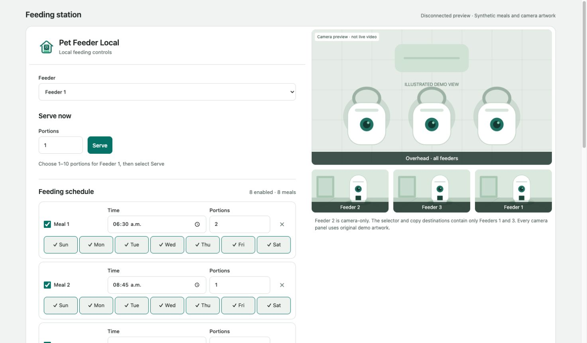
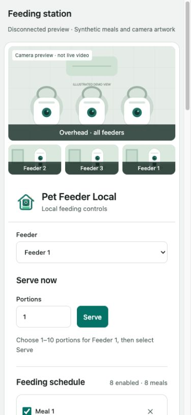
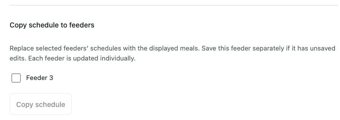

# Unified Home Assistant dashboard

The companion integration can select between two active feeders while displaying the three feeder cameras and an overhead view. The third feeder is camera-only. The bundled control card provides per-feeder drafts and optional, explicitly confirmed schedule copying.

These are disconnected documentation screenshots of the integration's actual bundled controls, with synthetic meals and original camera illustrations. They contain no home footage, credentials, device identities or household meal times. The real deployment separately verified all four playing local videos, both selector directions and exact preservation of both eight-row active schedules. No calendar copy or feeding command was issued while configuring that dashboard; see [three-device validation](validation.md#three-device-supervised-validation-2026-11-25).

Use the [companion setup guide and ready-to-edit card YAML](https://github.com/e2equiel/ha-pet-feeder-local/blob/main/docs/unified-dashboard.md) to reproduce the layout. The optional single-card composition uses Layout Card and Stack In Card; the bundled feeding card itself needs neither. Adding the dashboard and switching its selector do not rewrite the device calendars. Copy only when replacing a destination's whole schedule is intended.
